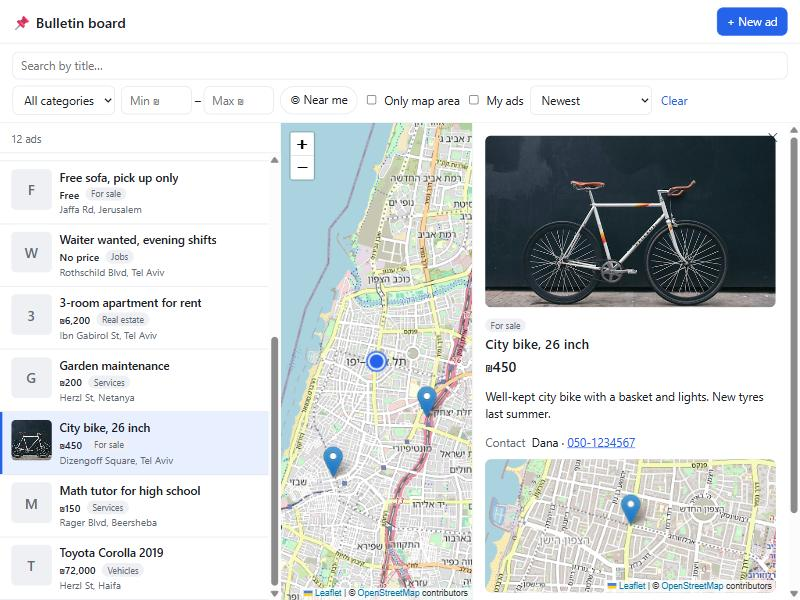

# Ads For All - Boards

A single-page bulletin board: a **React** SPA on top of a **.NET 10 REST API** that keeps the ads in a **local JSON file**.

- Browse every ad, newest first. **Search by title**, and filter by **category**, **price from–to** and **distance** (within 1–100 km of a place you pin on the map, or of your location).
- **Create, edit and delete** ads: the board is open to all, so anyone can change or remove any ad.
- **Bonus:** every ad has a map location, set by address search, clicking the map or dragging the pin. The board shows every ad on a map; search an address or click the map to pin your place, and the distance filter shows the ads near it.



## Run it

Prerequisites: [.NET 10 SDK](https://dotnet.microsoft.com/download) and [Node.js 20+](https://nodejs.org).

```bash
# 1. API: http://localhost:5280 (Swagger at /swagger)
cd server/BulletinBoard.Api
dotnet run
```

```bash
# 2. Client: http://localhost:5273 (proxies /api to the API)
cd client
npm install
npm run dev
```

The first run creates `server/BulletinBoard.Api/data/` from `SeedData/ads.json` (12 sample ads around Israel).

### Tests

```bash
dotnet test                       # API: 32 tests (filters, file store, two-server locking, HTTP)
cd client && npm test             # client: query building, validation, address labels
cd client && npm run typecheck
```

### Load 100,000 ads

```bash
dotnet run --project tools/BulletinBoard.DataGen -c Release -- 100000 server/BulletinBoard.Api/data
```

It's safe to run while the API is up: it takes the same file lock, and the API reloads on its next request.

## How it fits together

```
React SPA (one screen)                     .NET 10 API                          data folder
┌──────────────────────────┐   /api/ads    ┌──────────────────────────┐        ┌──────────────┐
│ filters │ list │ map │ ▢ │ ────────────► │ AdsController            │        │ ads.json     │ the ads
│         │      │     │ panel (view /   │ │  → AdService (rules)     │ ─────► │ ads.version  │ a counter
│         │      │     │ new / edit)     │ │  → JsonFileAdRepository  │        │ ads.lock     │ the lock
└──────────────────────────┘               └──────────────────────────┘        └──────────────┘
```

### Client (`client/`)

React 19 + TypeScript + Vite. One screen, no router: the filters bar, the ads list (one page of 20), the map, and a side panel that shows an ad or the create/edit form. Nothing reloads the page.

| Part | What it does |
|---|---|
| `App.tsx` | Holds the filters, page, selection and panel state; fetches the list and the map pins |
| `components/FiltersBar` | Title search (debounced), category, price from–to, distance (from the pinned place, or asks for your location the first time) |
| `components/AdsList` | One page of results, with edit and delete on every ad |
| `components/AdsMap` | Leaflet + OpenStreetMap; pins merge into numbered clusters; re-queries as you pan; a click pins your place |
| `components/PlaceSearch` | The address box over the board map: pins your place for the distance filter, or removes the pin |
| `components/AdPanel` / `AdDetails` / `AdForm` | View, create, edit, delete with confirmation |
| `components/LocationPicker` | Address search (Nominatim), click to place, drag to adjust; the address is looked up from the pin |
| `strings.ts` | Every user-visible string, so another language is one more object |

Maps use **Leaflet + OpenStreetMap tiles + Nominatim** address search, so no API key is needed.

### API (`server/BulletinBoard.Api/`)

| Endpoint | |
|---|---|
| `GET /api/ads?search=&category=&minPrice=&maxPrice=&lat=&lng=&radiusKm=&page=&pageSize=` | Search, newest first: one page plus the total |
| `GET /api/ads/pins?<same filters>&north=&south=&east=&west=` | Light pins for the map area in view (id, title, category, lat, lng), capped at 2,000 |
| `GET /api/ads/{id}` | One ad |
| `POST /api/ads` | Create (201 + Location) |
| `PUT /api/ads/{id}` | Edit an ad |
| `DELETE /api/ads/{id}` | Delete an ad (204) |

Errors are `ProblemDetails` JSON: 400 validation (with field errors), 404, 503 + `Retry-After` when the file is busy. A 500 never exposes internals.

| Class | Role |
|---|---|
| `AdsController` | HTTP only: binds the request, calls the service |
| `AdService` | Turns the query string into an `AdSearch` and the results into JSON; sets id / dates, trims text |
| `JsonFileAdRepository` + `AdFilter` (`Repositories.JsonFile`; the contract `IAdRepository` and its search types stay in `Repositories`) | Runs the search (filters, distance, newest first, paging, pins) on the in-memory snapshot, and the write procedure below |
| `SharedFolderFileStore` (`IFileStore`) | Streams `ads.json` in and out; safe save (temp file, then rename) |
| `SharedFileLock` (`IDistributedLock`) | The lock every server sees |
| `GeoDistance` / `BoundingBox` | Haversine distance; cheap rectangle check before the exact circle |

**No accounts:** the board is open to everyone, as the assignment asks. Anyone can edit or delete any ad, in the UI and through the API; the server doesn't check who made it. A real deployment would add a login (JWT) and store the user id on each ad, or give each ad a secret edit token returned when it is created.

## Keeping one JSON file consistent across servers

The store is designed for **several API instances sharing one folder**: a local folder in development, or a network share in the cloud (AWS EFS, Azure Files, Google Filestore, any NFS/SMB share, or a Kubernetes ReadWriteMany volume). Only `Storage:FolderPath` changes.

**Writing** (create / edit / delete):

1. `SemaphoreSlim(1,1)`: queues this server's own requests in memory, without blocking threads (`WaitAsync`).
2. `SharedFileLock`: opens `ads.lock` with `FileShare.None`. The OS, or the NFS/SMB file server, refuses a second exclusive open from any process on any machine. It retries with `await Task.Delay` plus jitter, and gives up with **503** after `LockTimeoutSeconds`. If a server dies while holding it, the OS closes the handle (on NFS, when its lease expires), so it can't stay locked the way a "marker file" lock can.
3. Read `ads.version`. If another server wrote since this one loaded, re-read `ads.json`.
4. Apply the change, on fresh data.
5. Save `ads.json` to a temp file and rename it into place, so a crash never leaves half a file.
6. Increment `ads.version`.

**Reading:** every server keeps the ads in memory as an immutable snapshot. Each read opens `ads.version` (a few bytes). If it changed, the server reloads `ads.json`, so it sees another server's ad on its **next request**. Opening the file, and not just checking its timestamp, is what makes NFS return fresh contents (close-to-open consistency). `FileSystemWatcher` is not used, because it doesn't see changes made by other machines on a network share.

`StorageTests` checks this with two repository instances on one folder: a write on one is seen by the other, a write on a stale instance doesn't lose the other's ad, and 50 concurrent writes from two instances are all kept.

## Size limits

Sized for **up to about 100,000 ads**. There is no hard limit: past that, every write and every reload just gets slower (see below).

Measured on a laptop with 100,000 generated ads (47.8 MB file):

| Operation | Time |
|---|---|
| Reload after another writer (whole file) | ~0.8–1.2 s, once per change |
| Search / filters / distance (one page) | 20–100 ms |
| Map pins for an area | ~35 ms |
| Create / edit / delete (rewrites the whole file under the lock) | ~0.5 s |
| 5 creates at once | queued: 0.4 s → 2.0 s, all saved |
| API process memory | ~190 MB |

The limit comes from the single file: every write rewrites it and every other server reloads it. Beyond ~100K:

- **Must stay JSON:** split into shards (for example by map area: `32.0_34.7.jsonl`), each with its own lock and version file, and keep only a slim index in memory (id, title, category, price, lat/lng, contact name, date). That's about 150–200 bytes per ad, roughly 200 MB for 1M ads, and full ads are read only for the page being shown.
- **Free choice:** a database (PostgreSQL + PostGIS, MongoDB with a geo index, DynamoDB). Only a new `IAdRepository` is needed: it turns the same `AdSearch` into a database query (`WHERE`, `ORDER BY created DESC LIMIT`, a geo index). The controller, service and client stay the same.

## Configuration (`appsettings.json`)

| Key | Default | |
|---|---|---|
| `Storage:FolderPath` | `data` | Where the three files live (the shared mount in the cloud) |
| `Storage:SeedFile` | `SeedData/ads.json` | Copied in when the folder is empty |
| `Storage:LockTimeoutSeconds` | `15` | Wait for the lock before 503 |
| `Storage:MaxPins` | `2000` | Most pins per map request |
| `Cors:Origins` | `http://localhost:5273` | Only needed when the client is hosted on another origin |
